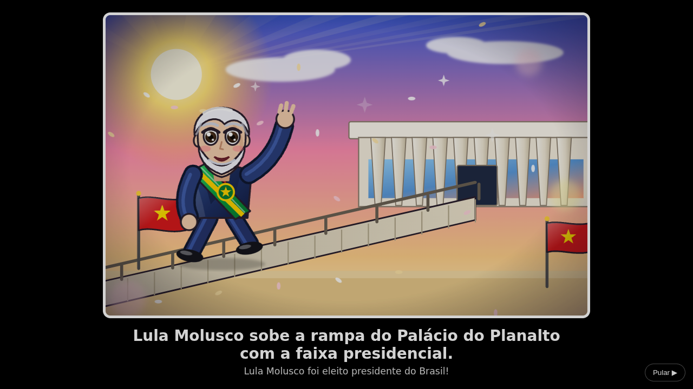
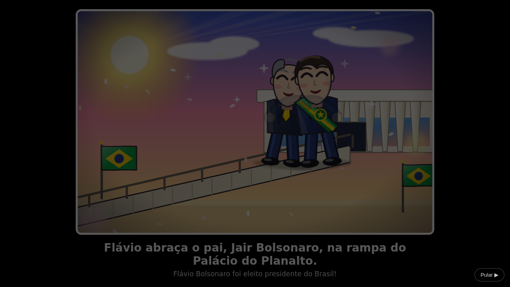
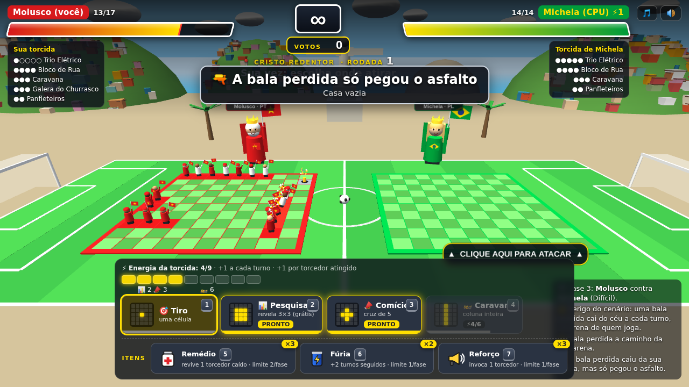

  

<h3 align="center">Use sua estratégia política para conquistar votos e vencer a corrida presidencial!</h3>

  Batalha naval das <b>eleições 2026</b>, em 3D, direto no navegador. 
  Uma campanha em 7 fases, 2 trilhas, 7 cenários do Brasil e um chefão final.

  <a href="https://rpossan.github.io/super-presida-batalha/"><b>▶ JOGAR AGORA</b></a>
  &nbsp;·&nbsp;
  <a href="#-aviso-legal-e-isenção-de-uso-de-imagem">Aviso legal</a>
  &nbsp;·&nbsp;
  <a href="#-me-pague-um-café">☕ Apoie</a>

  

> ### 🟢🟡 Jogo apartidário e imparcial
> **Super Presida Batalha é um jogo apartidário e imparcial.** Os dois lados são tratados da mesma forma:
> mesmas regras, mesmos poderes, mesma quantidade de fases, adversários e chefão, e um final para cada trilha.
> O jogo **não faz propaganda, não pede voto e não toma partido**. Nenhum lado é "o certo" ou "o errado":
> é só uma brincadeira de estratégia com humor.

---

## 🗳️ A corrida é sua

Duas torcidas tomaram o país. Você escolhe o lado, monta a sua campanha e vai de cidade em cidade
até o chefão final. **A estratégia política é sua:** onde posicionar a torcida, quando gastar a energia,
quando fazer uma pesquisa para descobrir onde o adversário se esconde e qual poder usar para virar o jogo.

- 🎯 **Cada acerto é um voto.** Encadeie acertos para ativar o **combo** (2x, 3x, 4x e **50x** no quinto seguido).
- 🧠 **Cada fase pede uma tática nova:** perigos do cenário, adversários mais espertos e um chefão que se esconde.
- 🏁 **Dois lados, duas histórias:** o final muda conforme a trilha que você escolheu.

> Dica de campanha: errar zera o combo e dá munição ao chefão. Faça uma **pesquisa** antes de arriscar.

---

## ✨ Destaques

| | |
|---|---|
| 🎮 **Batalha naval reinventada** | Tabuleiros 10×10 em 3D, torcedores animados e objetos de protesto (cone, tomate, bandeira, cavalete, chinelo, pedra e ovo) que ficam espalhados pela arena. |
| ⚡ **Poderes especiais** | Pesquisa, cruz (Buzinaço/Comício) e o poder final de cada lado: **Motociata** (linha inteira) e **Caravana** (coluna inteira), todos com animação própria. |
| 🌎 **7 cenários do Brasil** | Av. Paulista, Aeroporto de Porto Alegre, Cristo Redentor, Sertão, Amazônia, Balneário Camboriú e Praça dos Três Poderes. |
| ⚠️ **Perigos de cenário** | Bala perdida, fogo no sertão e chuva de flechas na floresta, em quantidade equilibrada ao nível. |
| 👑 **Chefões únicos** | Sem torcida, com pontos de vida, que mudam de casa a cada acerto e reagem aos seus erros. |
| 🎒 **Itens da campanha** | Remédio (revive um torcedor), Fúria (turnos seguidos) e Reforço (invoca um torcedor). Estoque limitado para o jogo todo: acabou, já era. |
| 🏆 **Votos e recorde** | Placar acumulado entre as fases, com combo e recorde pessoal. |
| 🎵 **Trilha sonora própria** | Uma música diferente por cenário (samba, baião, milonga, tambores, marcha…), gerada por código. |
| 📱 **Funciona no celular** | A câmera acompanha o turno: na sua vez, só a arena do adversário, para dar precisão no toque. |

---

## 🗺️ A campanha

Escolha o lado e vença uma fase por vez. Cada vitória libera a próxima e a dificuldade cresce.

| Fase | Cenário | Contra o **Flávio** (PL) | Contra o **Lula Molusco** (PT) | Nível | Perigo |
|---|---|---|---|---|---|
| 1 | Av. Paulista (SP) | Guilherme Bolos | Niko Ferrado | Fácil | — |
| 2 | Aeroporto Salgado Filho (RS) | G. Rofman | Tarcizinho | Médio | — |
| 3 | Cristo Redentor (RJ) | Alexandre sem Moral | Michela | Difícil | ⚠️ bala perdida |
| 4 | Sertão Nordestino | Felipe Feto | Véio da Avon | Muito difícil | 🔥 fogo |
| 5 | Floresta Amazônica | Marina Sílvia | Ricardo Venddas | Extremo | 🏹 flechas |
| 6 | Balneário Camboriú (SC) | Pablo Vital | Carlucho | Pré-chefão | 🏖️ sem danos |
| 7 | Praça dos Três Poderes (DF) | **Lula Molusco (chefão)** | **Flávio (chefão)** | Chefão | 👑 luta final |

### Cenários

<table>
  <tr>
    <td align="center"> <b>Av. Paulista</b> · objetos de protesto espalhados</td>
    <td align="center"> <b>Cristo Redentor</b> · campo de futebol e favela nos morros</td>
  </tr>
  <tr>
    <td align="center"> <b>Sertão</b> · fogo queima casas da arena</td>
    <td align="center"> <b>Amazônia</b> · chuva de flechas</td>
  </tr>
  <tr>
    <td align="center"> <b>Balneário Camboriú</b> · praia, sem danos</td>
    <td align="center"> <b>Motociata</b> · poder final que varre uma linha</td>
  </tr>
</table>

---

## 👑 O chefão final

O chefão é **único, sem torcida, e tem pontos de vida**. A cada acerto ele **muda de casa, escondido**.

- 👤 **Cada erro seu** faz surgir um seguidor visível. Acerte-o para eliminá-lo.
- 💥 **Lula Molusco:** com 6 petistas reunidos, eles **explodem 4 casas** da sua arena.
- 💚 **Flávio:** com 6 bolsonaristas reunidos, ele **recarrega a vida toda**.
- 📊 Use a **pesquisa** para descobrir em que área ele está.

---

## 🎬 Finais

Zere a trilha e veja o final: tela escurece, ilustração em estilo anime, seus **votos e recorde**,
créditos rolando e o QR code do Pix.

<table>
  <tr>
    <td align="center"> <b>Trilha do Lula Molusco</b></td>
    <td align="center"> <b>Trilha do Flávio</b></td>
  </tr>
</table>

---

## 🕹️ Como jogar

1. Escolha o lado e a fase.
2. **Posicione** sua torcida (5 grupos) no seu tabuleiro. `R` ou botão direito gira.
3. Na sua vez, **clique numa casa** do tabuleiro adversário. Cada tiro arremessa um objeto de protesto.
4. Acerte para ganhar **votos** e **energia**; gaste a energia nos poderes (`1`–`4`) e use os **itens** (`5`–`7`) com sabedoria.
5. Dispersse toda a torcida adversária (ou derrote o chefão) antes que ele faça o mesmo com a sua.

| Poder | Custo | Efeito |
|---|---|---|
| 🎯 Tiro | 0 | uma casa |
| 📊 Pesquisa | 2 | revela uma área 3×3 (grátis, não gasta o turno) |
| 📣 Buzinaço / Comício | 3 | cruz de 5 casas |
| 🏍️ Motociata / 🚌 Caravana | 6 | linha inteira / coluna inteira |

Energia: **+1 por turno** e **+1 por torcedor atingido**. No celular, a câmera acompanha o turno.

### 🎒 Itens da campanha

Além dos poderes, você carrega itens que valem para a **campanha toda**. O estoque é único e limitado:
o que acabou, acabou, e só volta se você recomeçar a jornada (game over ou campanha zerada).
Usar um item **não gasta o turno**.

| Item | Atalho | Efeito | Estoque na campanha | Limite por fase |
|---|---|---|---|---|
| 💊 **Remédio** (cruz vermelha) | `5` | revive 1 torcedor caído da sua torcida | **4** | 2 |
| 🥫 **Fúria** (energético) | `6` | turnos contínuos: você joga **3 turnos seguidos** (o atual + 2), sem o adversário agir | **2** | 1 |
| 📢 **Reforço** (alto-falante) | `7` | invoca 1 torcedor aleatório na sua arena (+1 de vida) | **3** | 1 |

Os números foram calibrados por simulação para os itens ajudarem sem tirar o desafio: no chefão final,
um jogador competente passa de ~60% para ~70% de vitória usando tudo o que a fase permite.
A Fúria é o item mais forte, por isso é o mais raro. O perigo do cenário não se repete nos turnos extras.

---

## 🛠️ Tecnologia

- Arquivo único: [`index.html`](index.html), com [Three.js](https://threejs.org/) via CDN. Sem build, sem servidor.
- Personagens, cenários, músicas, efeitos sonoros e ilustrações são **gerados por código** (3D, SVG e Web Audio).
- Progresso da campanha só em memória (recarregar recomeça); o recorde fica no navegador.

Para rodar localmente, abra o `index.html` no navegador. Para criar um cenário novo, adicione um objeto em
`SCENARIOS` e uma fase em `LEVELS` (há um comentário `ADICIONE NOVOS CENÁRIOS AQUI`).

---

## ☕ Me pague um café

Curtiu? Ajude o desenvolvedor a continuar criando fases. Dentro do jogo há o botão **"Me pague um café"**
com a chave Pix e o QR code:

**Pix:** `9a706f09-753c-4143-b055-197c082e9201`

---

## ⚖️ Aviso legal e isenção de uso de imagem

**Este é um jogo de paródia e de ficção, feito com fins de entretenimento e humor.**

- **Apartidário e imparcial.** O jogo não é vinculado a nenhum partido, candidato ou campanha e trata os dois
  lados de forma equivalente (mesmas regras, poderes, fases e finais). Não defende nem ataca nenhum lado.
- **Não é propaganda eleitoral.** O jogo não pede voto, não apoia nem combate candidato, partido, coligação
  ou campanha, e não deve ser usado como material de propaganda.
- **Nenhuma imagem real é usada.** Não há fotografias, retratos, vozes ou gravações de qualquer pessoa.
  Todos os personagens são **desenhos originais, estilizados e genéricos**, criados por código, que não
  pretendem retratar fielmente nem representar ninguém.
- **Nomes citados apenas para identificar a paródia.** Os nomes de figuras públicas aparecem em tom de sátira
  e humor político. Falas, situações, poderes e finais são **fictícios** e não representam fatos, declarações,
  posições ou opiniões reais dessas pessoas.
- **Sem vínculo ou endosso.** Nenhuma pessoa, partido, candidato, instituição, órgão público ou empresa
  citados participou, patrocinou, aprovou ou tem qualquer relação com este projeto. Siglas, nomes e marcas
  pertencem aos seus respectivos titulares e são citados apenas de forma descritiva.
- **Sem violência real.** Quem é "atingido" apenas senta, cansado de tanto gritar.
- **Sem coleta de dados.** O jogo roda no seu navegador; o progresso e o recorde ficam apenas nele.
- **Pedidos de ajuste ou remoção** podem ser feitos abrindo uma *issue* neste repositório ou contatando
  o autor, e serão analisados com atenção.

> Este texto é informativo e não constitui assessoria jurídica.

---

  Feito com ☕ e paciência por <b>rpossan</b> · <a href="https://github.com/rpossan/super-presida-batalha">github.com/rpossan/super-presida-batalha</a>

