

  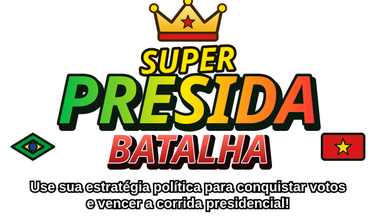

<h3 align="center">Use sua estratégia política para conquistar votos e vencer a corrida presidencial!</h3>

  Batalha naval das <b>eleições 2026</b>, em 3D, direto no navegador. 
  Uma campanha em 7 fases, 2 trilhas, 7 cenários do Brasil, um chefão final e um modo NG+ apocalíptico.

  <a href="https://rpossan.github.io/super-presida-batalha/"><b>▶ JOGAR AGORA</b></a>
  &nbsp;·&nbsp;
  <a href="#-aviso-legal-e-isenção-de-uso-de-imagem">Aviso legal</a>
  &nbsp;·&nbsp;
  <a href="#-me-pague-um-café">☕ Apoie</a>

  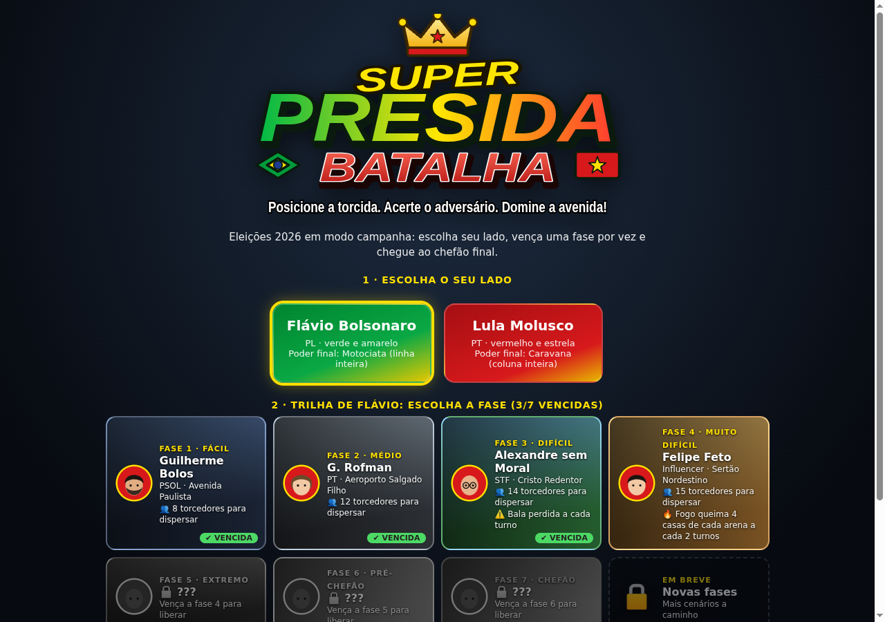

> ### 🟢🟡 Jogo apartidário e imparcial
> **Super Presida Batalha é um jogo apartidário e imparcial.** Os dois lados são tratados da mesma forma:
> mesmas regras, mesmos poderes, mesma quantidade de fases, adversários e chefão, e uma conclusão para cada trilha.
> O jogo **não faz propaganda, não pede voto e não toma partido**. Nenhum lado é "o certo" ou "o errado":
> é só uma brincadeira de estratégia com humor.

---

## 🗳️ A corrida é sua

Duas torcidas tomaram o país. Você escolhe o lado, monta a sua campanha e vai de cidade em cidade
até o chefão final. **A estratégia política é sua:** onde posicionar a torcida, quando gastar a energia,
quando fazer uma pesquisa para descobrir onde o adversário se esconde e qual poder usar para virar o jogo.

- 🎯 **Cada acerto é um voto.** Encadeie acertos para ativar o **combo** (2x, 3x, 4x e **50x** no quinto seguido).
- 🧠 **Cada fase pede uma tática nova:** perigos do cenário, adversários mais espertos e um chefão que se esconde.
- 🏁 **Dois lados, duas histórias:** cada trilha tem o seu próprio desfecho.

> Dica de campanha: errar zera o combo e dá munição ao chefão. Faça uma **pesquisa** antes de arriscar.

---

## ✨ Destaques

| | |
|---|---|
| 🎮 **Batalha naval reinventada** | Tabuleiros 10×10 em 3D, torcedores animados e objetos de protesto (cone, tomate, bandeira, cavalete, chinelo, pedra e ovo) que ficam espalhados pela arena. |
| ⚡ **Poderes especiais** | Pesquisa, cruz (Buzinaço/Comício) e o poder final de cada lado: **Motociata** (linha inteira) e **Caravana** (coluna inteira), todos com animação própria. |
| 🌎 **7 cenários do Brasil** | Av. Paulista, Aeroporto de Porto Alegre, Cristo Redentor, Sertão, Amazônia, Balneário Camboriú e Praça dos Três Poderes. |
| ⚠️ **Perigos de cenário** | Bala perdida, fogo no sertão e chuva de flechas na floresta, em quantidade equilibrada ao nível. |
| 👑 **Chefões únicos** | Sem torcida, com pontos de vida, que mudam de casa a cada acerto e reagem aos seus erros. |
| 🛒 **Loja, itens e skills** | Gaste seus votos em itens (Remédio, Fúria, Reforço) e desbloqueie skills permanentes (Empolgação, Super tiro, Guarda-chuva, Instituto de pesquisa, Fôlego). [Veja a seção](#-itens-e-skills). |
| 🏆 **Votos e recorde** | Placar acumulado entre as fases, com combo e recorde pessoal. |
| 🎵 **Trilha sonora própria** | Uma música diferente por cenário (samba, baião, milonga, tambores, marcha…), gerada por código. |
| 📱 **Funciona no celular** | A câmera acompanha o turno: na sua vez, só a arena do adversário, para dar precisão no toque. |

---

## 🗺️ A campanha

Escolha o lado e vença uma fase por vez. Cada vitória libera a próxima e a dificuldade cresce.

| Fase | Cenário | Contra o **Flávio** (PL) | Contra o **Lula Molusco** (PT) | Nível | Perigo |
|---|---|---|---|---|---|
| 1 | Av. Paulista (SP) | Guilherme Bolos | Niko Ferrado | Fácil | — |
| 2 | Aeroporto Salgado Filho (RS) | G. Rofman | Tarcizinho | Médio | — |
| 3 | Cristo Redentor (RJ) | Alexandre sem Moral | Michela | Difícil | ⚠️ bala perdida |
| 4 | Sertão Nordestino | Felipe Feto | Véio da Avon | Muito difícil | 🔥 fogo |
| 5 | Floresta Amazônica | Marina Sílvia | Ricardo Venddas | Extremo | 🏹 flechas |
| 6 | Balneário Camboriú (SC) | Pablo Vital | Carlucho | Pré-chefão | 🏖️ sem danos |
| 7 | Praça dos Três Poderes (DF) | **Lula Molusco (chefão)** | **Flávio (chefão)** | Chefão | 👑 luta final |
| 8 | Apocalipse (NG+) | **Generalíssimo Tirano** | **Generalíssimo Tirano** | NG+ extremo | ☢️ bombas + 🧟 zumbis |

### Cenários

<table>
  <tr>
    <td align="center">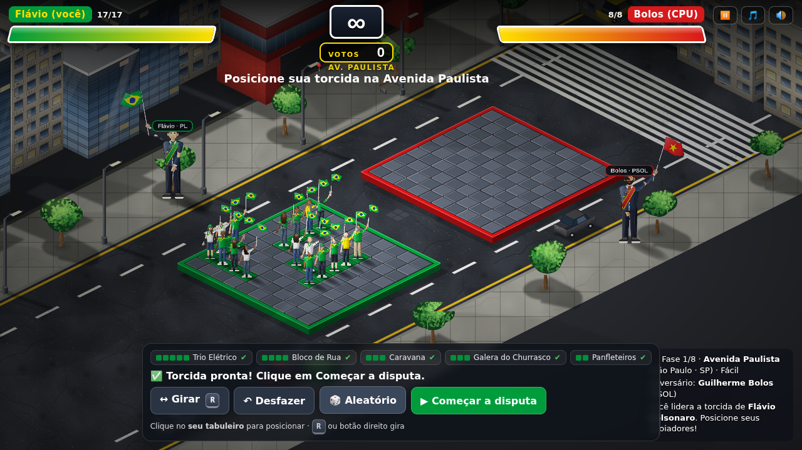 <b>Av. Paulista</b> · objetos de protesto espalhados</td>
    <td align="center">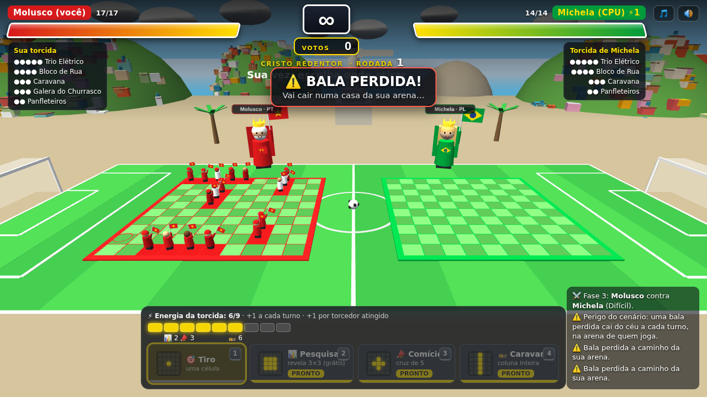 <b>Cristo Redentor</b> · campo de futebol e favela nos morros</td>
  </tr>
  <tr>
    <td align="center">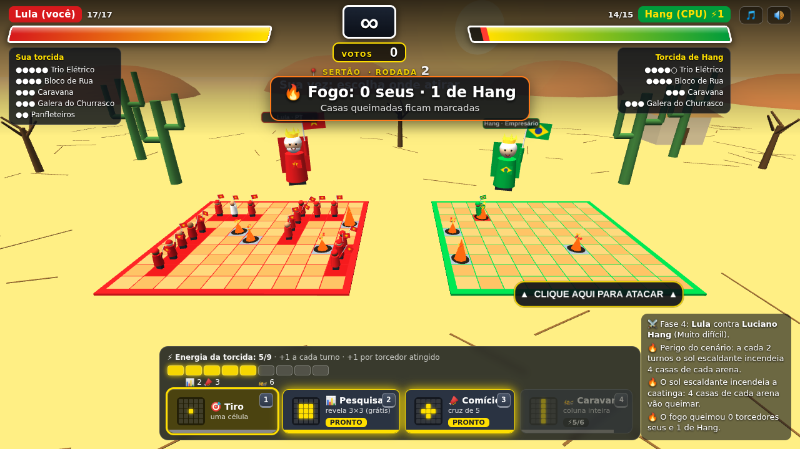 <b>Sertão</b> · fogo queima casas da arena</td>
    <td align="center">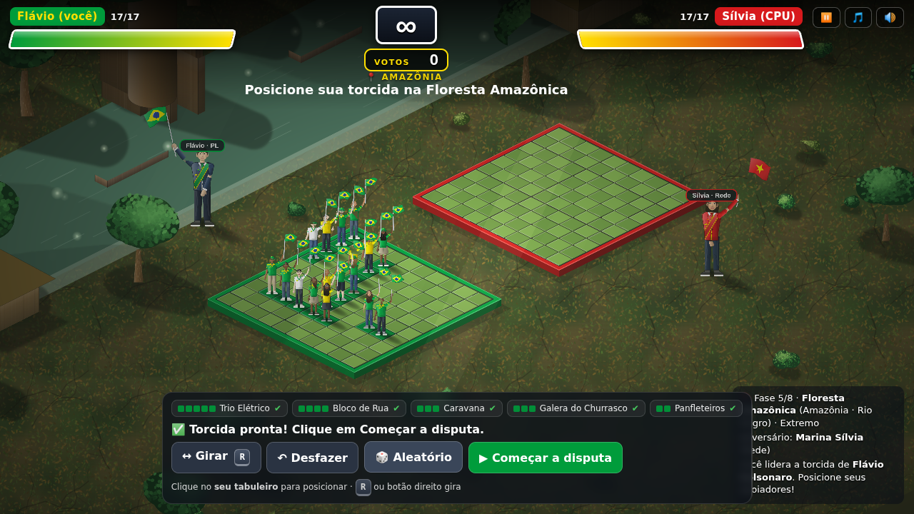 <b>Amazônia</b> · chuva de flechas</td>
  </tr>
  <tr>
    <td align="center">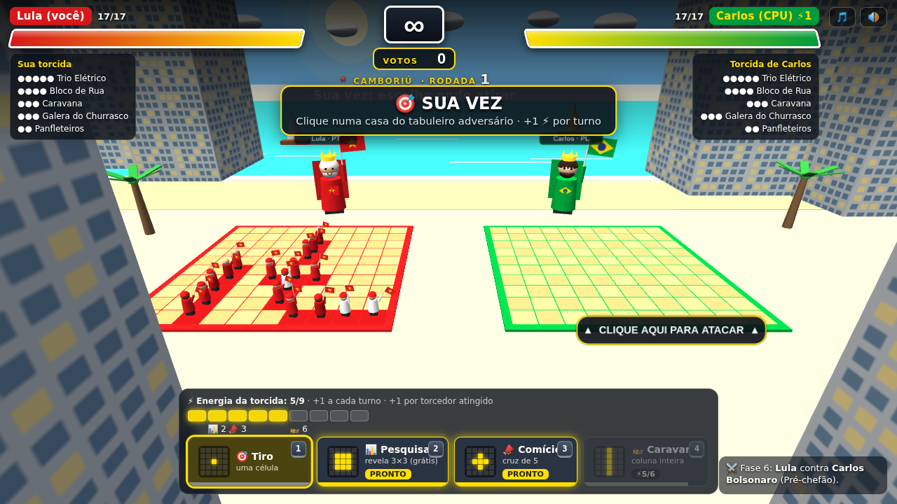 <b>Balneário Camboriú</b> · praia, sem danos</td>
    <td align="center">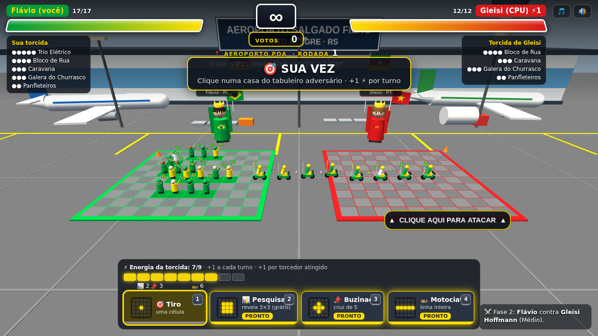 <b>Motociata</b> · poder final que varre uma linha</td>
  </tr>
</table>

---

## 👑 O chefão final

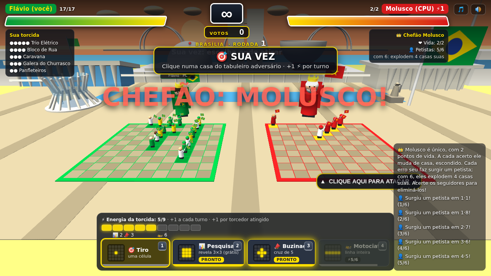

O chefão é **único, sem torcida, e tem pontos de vida**. A cada acerto ele **muda de casa, escondido**.

- 👤 **Cada erro seu** faz surgir um seguidor visível. Acerte-o para eliminá-lo.
- 💥 **Lula Molusco:** com 6 petistas reunidos, eles **explodem 4 casas** da sua arena.
- 💚 **Flávio:** com 6 bolsonaristas reunidos, ele **recarrega a vida toda**.
- 📊 Use a **pesquisa** para descobrir em que área ele está.

---

## ☢️ NG+: Apocalipse

Zerou a campanha e viu os créditos? Um ditador surge das cinzas. **O NG+ é desbloqueado depois dos créditos** e é a fase mais difícil do jogo.

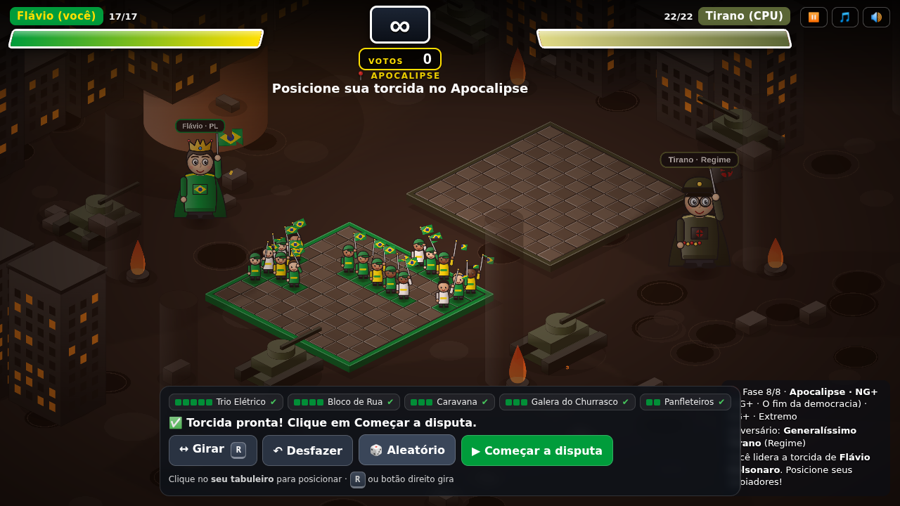

- **Cenário:** terra arrasada, prédios em chamas, **tanques de guerra**, **caças voando** ao fundo e um **cogumelo nuclear** no centro.
- **Inimigo:** o **Generalíssimo Tirano**, um ditador que é contra a democracia (personagem fictício). É o mesmo adversário nas duas trilhas.
- **Exército:** zumbis, soldados e monstros (20 unidades, contra as 17 da sua torcida).
- **☢️ Bombas:** caem a cada turno e atingem uma cruz de 5 casas: antes do seu ataque no inimigo, antes do ataque dele em você.
  A cada 3 rodadas cai uma bomba a mais (até 3).
- **🧟 Zumbis:** cada vez que você erra, surge um zumbi visível na casa. Acerte-o para eliminá-lo. Com **5 zumbis**, a horda invade e morde 5 casas da sua arena.
- **Dificuldade extrema:** o Tirano começa com mais energia e ganha energia extra a cada turno.

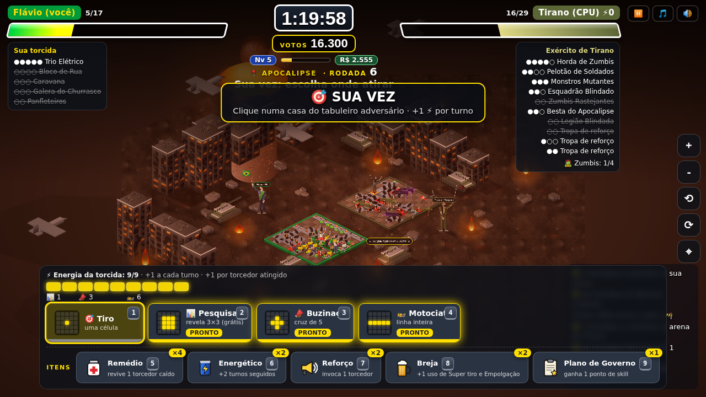

> A dificuldade acompanha a **ameaça** (veja [Ameaça e equilíbrio](#️-ameaça-e-equilíbrio)): quanto mais você investe em skills, mais exércitos, bombas e zumbis o Tirano manda.

---

## 🎒 Itens e skills

Além dos poderes de energia, você tem **itens** (gastáveis, limitados) e **skills** (permanentes). Tudo se compra na
**🛒 Loja**, com os **votos** que você ganha acertando alvos. O botão da loja fica no menu principal e ao fim de cada fase.

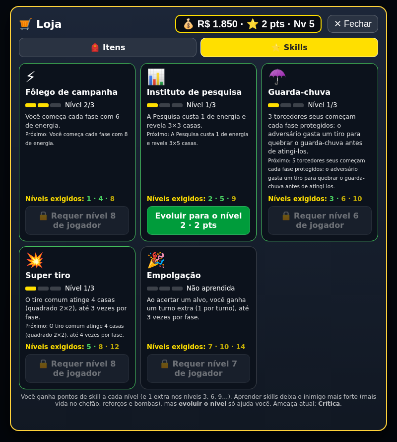

### 🎒 Itens
Estoque único para a campanha toda: **acabou, já era**. Usar um item **não gasta o turno**. O *game over* repõe o estoque inicial.

| Item | Atalho | Efeito | Estoque inicial | Limite por fase | Preço | Máx. |
|---|---|---|---|---|---|---|
| 💊 **Remédio** (cruz vermelha) | `5` | revive 1 torcedor caído da sua torcida | 4 | 2 | 1.000 | 9 |
| 🥫 **Fúria** (energético) | `6` | turnos contínuos: joga 3 turnos seguidos (o atual + 2), sem o adversário agir | 2 | 1 | 3.000 | 9 |
| 📢 **Reforço** (alto-falante) | `7` | invoca 1 torcedor aleatório na sua arena (+1 de vida) | 3 | 1 | 1.500 | 9 |

No celular os itens ficam num botão único **🎒 Itens** que abre a lista.

### ⭐ Skills
Compra única. Depois de desbloqueada, a skill vale em **todas as fases e cenários**, das duas trilhas, e fica ativa sozinha.
Ficam salvas no navegador (veja [Salvamento](#-salvamento-local)).

| Skill | Preço | Efeito |
|---|---|---|
| ⚡ **Fôlego de campanha** | 3.000 | começa cada fase com 4 de energia (em vez de 1) |
| 📊 **Instituto de pesquisa** | 4.000 | a Pesquisa custa 1 de energia (em vez de 2) |
| ☂️ **Guarda-chuva** | 6.000 | 3 torcedores começam cada fase protegidos; o adversário gasta um tiro para quebrar a proteção |
| 💥 **Super tiro** | 8.000 | o tiro comum atinge 4 casas (quadrado 2×2), até 3 vezes por fase |
| 🎉 **Empolgação** | 10.000 | ao acertar um alvo, ganha um turno extra (1 por turno), até 3 vezes por fase |

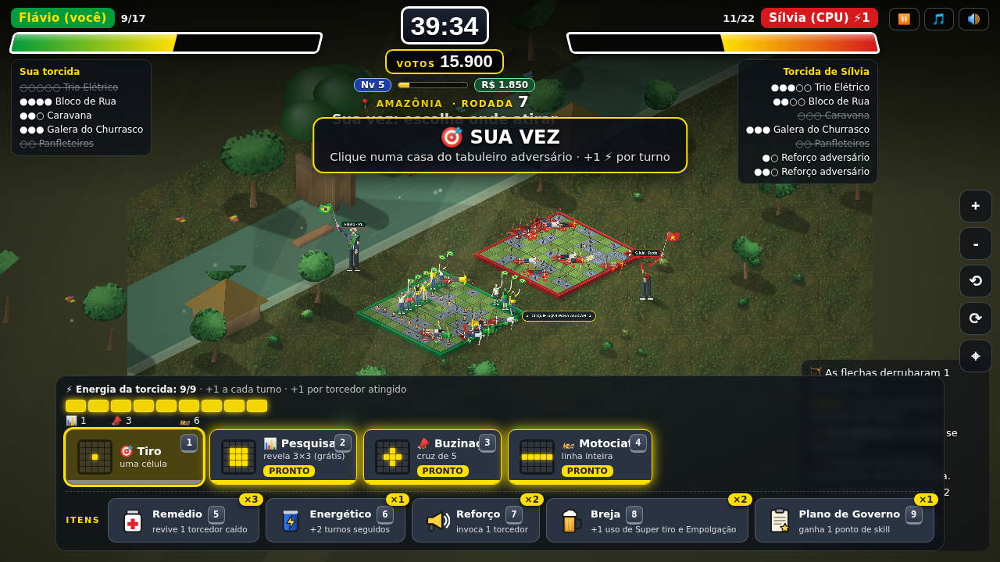

### ⚖️ Ameaça e equilíbrio
As skills ajudam, mas **quanto mais votos você investe nelas, mais forte o inimigo fica**. A *ameaça* é o total gasto em skills
(em milhares de votos, de 0 a 31) e muda de nível: **Calma → Moderada → Elevada → Alta → Crítica → Extrema**.
O jogo avisa o nível no começo de cada fase e na aba de skills da loja.

| Ameaça (votos gastos) | Fases comuns | Chefão final (Lula Molusco / Flávio) | Apocalipse (NG+) |
|---|---|---|---|
| 0 (nenhuma skill) | base | 3 de vida, descansa em 20% dos turnos, 6 seguidores, explosão de 4 casas | base: 22 unidades, bombas a cada 3 rodadas |
| 7 | base | 4 de vida | +1 grupo de reforço |
| 14 | +1 grupo de reforço, inimigo ganha energia extra | explosão de 5 casas | +2 grupos, bombas escalam a cada 2 rodadas |
| 21 | +2 grupos | 5 de vida, 5 seguidores, explosão de 6 | +3 grupos, zumbis em 4 (e não 5), mordida de 7, energia extra |
| 31 (todas) | +3 grupos | 6 de vida, 4 seguidores, explosão de 7, quase não descansa | máximo de tudo |

**Como foi calibrado:** simulação do chefão e do Apocalipse com um jogador competente **usando skills e itens**. Os itens
pesam bastante: sem considerá-los o chefão parecia equilibrado, mas na prática dava cerca de 79% de vitória. Agora o chefão
fica em torno de **50% sem skills e ~25% com todas**, e o Apocalipse em torno de **30%**, em qualquer nível de investimento.
Jogadores humanos tendem a ir melhor que o simulador, então a sensação real deve ser um pouco mais confortável.

---

## 🕹️ Como jogar

1. Escolha o lado e a fase.
2. **Posicione** sua torcida (5 grupos) no seu tabuleiro. `R` ou botão direito gira.
3. Na sua vez, **clique numa casa** do tabuleiro adversário. Cada tiro arremessa um objeto de protesto.
4. Acerte para ganhar **votos** e **energia**; gaste a energia nos poderes (`1`–`4`) e use os **itens** (`5`–`7`) com sabedoria. Veja [Itens e skills](#-itens-e-skills).
5. Dispersse toda a torcida adversária (ou derrote o chefão) antes que ele faça o mesmo com a sua.

| Poder | Custo | Efeito |
|---|---|---|
| 🎯 Tiro | 0 | uma casa |
| 📊 Pesquisa | 2 | revela uma área 3×3 (grátis, não gasta o turno) |
| 📣 Buzinaço / Comício | 3 | cruz de 5 casas |
| 🏍️ Motociata / 🚌 Caravana | 6 | linha inteira / coluna inteira |

Energia: **+1 por turno** e **+1 por torcedor atingido**. No celular, a câmera acompanha o turno.

### ⏸ Pausa e modo desenvolvedor

- **Pausa:** botão ⏸ no topo (ou `Esc`) congela o jogo e abre o menu com **Continuar**, **Reiniciar a fase** e
  **Sair para o menu principal**. Reiniciar ou sair desfaz os votos e itens gastos na fase em andamento.
- **Modo desenvolvedor:** vem **desligado**. Abra o jogo com `?dev=1` na URL para liberar todas as fases (e um saldo de testes na loja).
  Com `?dev=` na URL aparece o botão "🛠 Modo desenvolvedor" no menu para ligar e desligar.

## 🛠️ Tecnologia

- Arquivo único: [`index.html`](index.html), com [Three.js](https://threejs.org/) via CDN. Sem build, sem servidor.
- Personagens, cenários, músicas, efeitos sonoros e ilustrações são **gerados por código** (3D, SVG e Web Audio).
- Progresso salvo no navegador (`localStorage`), sem servidor: veja [Salvamento](#-salvamento-local).

Para rodar localmente, abra o `index.html` no navegador. Para criar um cenário novo, adicione um objeto em
`SCENARIOS` e uma fase em `LEVELS` (há um comentário `ADICIONE NOVOS CENÁRIOS AQUI`).

---

## 💾 Salvamento local

O jogo **salva sozinho no seu navegador** (`localStorage`), mesmo hospedado no GitHub Pages. Nada vai para servidor nenhum.

- **O que é salvo:** fases desbloqueadas e vencidas (nas duas trilhas), saldo de votos da loja, skills compradas, estoque de itens, recorde e as preferências de som e música.
- **Quando salva:** entre as fases (ao terminar uma fase, comprar na loja ou voltar ao menu) e ao fechar a aba. Não salva no meio de uma partida: se você fechar durante uma fase, volta ao estado do início dela.
- **Onde fica:** só naquele navegador e aparelho; não sincroniza entre computador e celular. Limpar os dados do site, usar aba anônima ou trocar de navegador perde o progresso.
- **Apagar:** botão **"🗑 Apagar progresso salvo"** no menu principal.
- **Modo desenvolvedor:** nunca grava nem usa o saldo de teste.
- Se o navegador bloquear o armazenamento, o jogo funciona normalmente, só não salva.

---

## ☕ Me pague um café

Curtiu? Ajude o desenvolvedor a continuar criando fases. Dentro do jogo há o botão **"Me pague um café"**
com a chave Pix e o QR code:

**Pix:** `9a706f09-753c-4143-b055-197c082e9201`

---

## ⚖️ Aviso legal e isenção de uso de imagem

**Este é um jogo de paródia e de ficção, feito com fins de entretenimento e humor.**

- **Apartidário e imparcial.** O jogo não é vinculado a nenhum partido, candidato ou campanha e trata os dois
  lados de forma equivalente (mesmas regras, poderes, fases e finais). Não defende nem ataca nenhum lado.
- **Não é propaganda eleitoral.** O jogo não pede voto, não apoia nem combate candidato, partido, coligação
  ou campanha, e não deve ser usado como material de propaganda.
- **Nenhuma imagem real é usada.** Não há fotografias, retratos, vozes ou gravações de qualquer pessoa.
  Todos os personagens são **desenhos originais, estilizados e genéricos**, criados por código, que não
  pretendem retratar fielmente nem representar ninguém.
- **Nomes citados apenas para identificar a paródia.** Os nomes de figuras públicas aparecem em tom de sátira
  e humor político. Falas, situações, poderes e finais são **fictícios** e não representam fatos, declarações,
  posições ou opiniões reais dessas pessoas.
- **Sem vínculo ou endosso.** Nenhuma pessoa, partido, candidato, instituição, órgão público ou empresa
  citados participou, patrocinou, aprovou ou tem qualquer relação com este projeto. Siglas, nomes e marcas
  pertencem aos seus respectivos titulares e são citados apenas de forma descritiva.
- **Sem violência real.** Quem é "atingido" apenas senta, cansado de tanto gritar.
- **Sem coleta de dados.** O jogo roda no seu navegador; o progresso e o recorde ficam apenas nele.
- **Pedidos de ajuste ou remoção** podem ser feitos abrindo uma *issue* neste repositório ou contatando
  o autor, e serão analisados com atenção.

> Este texto é informativo e não constitui assessoria jurídica.

---

  Feito com ☕ e paciência por <b>rpossan</b> · <a href="https://github.com/rpossan/super-presida-batalha">github.com/rpossan/super-presida-batalha</a>

