

  

<h3 align="center">Use sua estratégia política para conquistar votos e vencer a corrida presidencial!</h3>

  Batalha naval das <b>eleições 2026</b>, em 2.5D isométrico com visual realista, direto no navegador. 
  Uma campanha em 7 fases, 2 trilhas, 7 cenários do Brasil, um chefão final, um final cinematográfico e um modo NG+ apocalíptico. 
  Este é o <b>REMAKE</b> do <a href="https://github.com/rpossan/super-presida-batalha">Super Presida Batalha original</a>.

  <a href="https://rpossan.github.io/super-batalha-presida-remake/"><b>▶ JOGAR AGORA</b></a>
  &nbsp;·&nbsp;
  <a href="#-o-remake">🆕 O que mudou no remake</a>
  &nbsp;·&nbsp;
  <a href="#-aviso-legal-e-isenção-de-uso-de-imagem">Aviso legal</a>
  &nbsp;·&nbsp;
  <a href="#-me-pague-um-café">☕ Apoie</a>

  

> ### 🟢🟡 Jogo apartidário e imparcial
> **Super Presida Batalha é um jogo apartidário e imparcial.** Os dois lados são tratados da mesma forma:
> mesmas regras, mesmos poderes, mesma quantidade de fases, adversários e chefão, e uma conclusão para cada trilha.
> O jogo **não faz propaganda, não pede voto e não toma partido**. Nenhum lado é "o certo" ou "o errado":
> é só uma brincadeira de estratégia com humor.

---

## 🆕 O remake

Tudo foi refeito sobre a mesma ideia do [jogo original](https://github.com/rpossan/super-presida-batalha), agora em **2.5D isométrico** com [Phaser 4](https://phaser.io/):

| Original | Remake |
|---|---|
| Visual simples em 3D de blocos | **Pessoas realistas e articuladas**, cenários com texturas, sombras projetadas e árvores ao vento, veículos e efeitos melhores |
| Câmera fixa | **Zoom** (roda, pinça, `+`/`-`), **arrastar** para mover e **giro da vista** em 4 ângulos (`Q`/`E`) |
| Jogador sem progressão | **Progressão de RPG:** votos viram experiência (níveis 1 a 15), pontos de skill, grana e saque, com tela de resultados e *LEVEL UP!* |
| Skills simples | **Skills com 3 níveis**, trava por fase vencida e ameaça que cresce com o seu poder |
| 3 itens | **5 itens** (Remédio, Energético, Reforço, **Breja** e **Plano de Governo**), só na loja ou no saque |
| Reações genéricas | **Vozes e gritos** de quem é atingido (falas em pt-BR) e gemidos nos zumbis |
| Trilha única | **Uma música por cenário**, gerada por código |
| Final curto | **Final cinematográfico** de mais de 2 minutos, com a câmera na festa, fogos, a cena da posse, a linha do tempo da campanha e créditos |
| Sem cronômetro | **Cronômetro de jogo** que registra quanto tempo você levou para zerar, com melhor tempo e tempo por fase |

---

## 🗳️ A corrida é sua

Duas torcidas tomaram o país. Você escolhe o lado, monta a sua campanha e vai de cidade em cidade
até o chefão final. **A estratégia política é sua:** onde posicionar a torcida, quando gastar a energia,
quando fazer uma pesquisa para descobrir onde o adversário se esconde e qual poder usar para virar o jogo.

- 🎯 **Cada acerto é um voto (experiência).** Encadeie acertos para ativar o **combo** (2x, 3x… até **8x**), suba de nível e saqueie grana dos adversários.
- 🧠 **Cada fase pede uma tática nova:** perigos do cenário, adversários mais espertos e um chefão que se esconde.
- 🏁 **Dois lados, duas histórias:** cada trilha tem o seu próprio desfecho.

> Dica de campanha: errar zera o combo e dá munição ao chefão. Faça uma **pesquisa** antes de arriscar.

---

## ✨ Destaques

| | |
|---|---|
| 🎮 **Batalha naval reinventada** | Tabuleiros 10×10 isométricos, torcedores como pessoas de verdade (corpo articulado, roupas, rostos, bandeiras de pano) e cenários com texturas, sombras projetadas e árvores ao vento, torcedores animados e objetos de protesto (cone, tomate, bandeira, cavalete, chinelo, pedra e ovo) que ficam espalhados pela arena. |
| ⚡ **Poderes especiais** | Pesquisa, cruz (Buzinaço/Comício) e o poder final de cada lado: **Motociata** (linha inteira) e **Caravana** (coluna inteira), todos com animação própria. |
| 🌎 **7 cenários do Brasil** | Av. Paulista, Aeroporto de Porto Alegre, Cristo Redentor, Sertão, Amazônia, Balneário Camboriú e Praça dos Três Poderes. |
| ⚠️ **Perigos de cenário** | Bala perdida, fogo no sertão e chuva de flechas na floresta, em quantidade equilibrada ao nível. |
| 👑 **Chefões únicos** | Sem torcida, com pontos de vida, que mudam de casa a cada acerto e reagem aos seus erros. |
| 🛒 **Loja, itens e skills** | Compre itens com a grana do saque e aprenda skills com pontos de nível (Empolgação, Super tiro, Guarda-chuva, Instituto de pesquisa, Fôlego). [Veja a seção](#️-níveis-grana-itens-e-skills). |
| 🎬 **Final cinematográfico** | Ao vencer o chefão: câmera passeando pela festa com fogos e confete, a cena da posse, a **linha do tempo da sua campanha** (fase a fase, com o tempo de cada uma) e créditos. [Veja a seção](#-o-final). |
| 🏆 **Nível, votos e recorde** | Votos são experiência (nunca zeram), com tela de resultados e *LEVEL UP!*; combo e recorde pessoal. |
| ⏱️ **Cronômetro de jogo** | O relógio do topo conta o tempo jogado na trilha (pausa e menu não contam, e ele não encerra a partida). Ao zerar, o final mostra o tempo por fase e o melhor tempo. |
| 🌐 **Modo online** | Duelo 1×1 contra outros jogadores: **partida aleatória** ou **desafio pelo ID**, com tabuleiros escondidos e conferidos no fim. [Veja a seção](#-modo-online). |
| 🗺️ **Mapa de campanhas** | O Brasil 2026 é o **Mundo 1**; outras campanhas (Copa do Mundo, eleições de outros países…) entram como novos mundos, com lados, personagens, cenários, itens e skills próprios, no mesmo motor. [Guia de campanhas](CAMPANHAS.md). |
| 🙋 **Perfil do jogador** | Crie o seu **nick** e monte o **avatar** (pele, cabelo, boné, camisa, fundo, óculos, barba). Aparece no menu, na batalha, nos resultados e no final, com estatísticas e **backup**. [Veja a seção](#-seu-perfil). |
| 🎵 **Trilha sonora própria** | Uma música diferente por cenário (samba, baião, milonga, tambores, marcha…), gerada por código. |
| 📱 **Funciona no celular** | A câmera acompanha o turno: na sua vez, só a arena do adversário, para dar precisão no toque. |

---

## 🗺️ A campanha

Escolha o lado e vença uma fase por vez. Cada vitória libera a próxima e a dificuldade cresce.

| Fase | Cenário | Contra o **Flávio** (PL) | Contra o **Lula Molusco** (PT) | Nível | Perigo |
|---|---|---|---|---|---|
| 1 | Av. Paulista (SP) | Guilherme Bolos | Niko Ferrado | Fácil | — |
| 2 | Aeroporto Salgado Filho (RS) | G. Rofman | Tarcizinho | Médio | — |
| 3 | Cristo Redentor (RJ) | Alexandre sem Moral | Michela | Difícil | ⚠️ bala perdida |
| 4 | Sertão Nordestino | Felipe Feto | Véio da Avon | Muito difícil | 🔥 fogo |
| 5 | Floresta Amazônica | Marina Sílvia | Ricardo Venddas | Extremo | 🏹 flechas |
| 6 | Balneário Camboriú (SC) | Pablo Vital | Carlucho | Pré-chefão | 🏖️ sem danos |
| 7 | Praça dos Três Poderes (DF) | **Lula Molusco (chefão)** | **Flávio (chefão)** | Chefão | 👑 luta final |
| 8 | Apocalipse (NG+) | **Generalíssimo Tirano** | **Generalíssimo Tirano** | NG+ extremo | ☢️ bombas + 🧟 zumbis |

### Cenários

<table>
  <tr>
    <td align="center"> <b>Av. Paulista</b> · objetos de protesto espalhados</td>
    <td align="center"> <b>Cristo Redentor</b> · campo de futebol e favela nos morros</td>
  </tr>
  <tr>
    <td align="center"> <b>Sertão</b> · fogo queima casas da arena</td>
    <td align="center"> <b>Amazônia</b> · chuva de flechas</td>
  </tr>
  <tr>
    <td align="center"> <b>Balneário Camboriú</b> · praia, sem danos</td>
    <td align="center"> <b>Motociata</b> · poder final que varre uma linha</td>
  </tr>
</table>

---

## 👑 O chefão final

O chefão é **único, sem torcida, e tem pontos de vida**. A cada acerto ele **muda de casa, escondido**.

- 👤 **Cada erro seu** faz surgir um seguidor visível. Acerte-o para eliminá-lo.
- 💥 **Lula Molusco:** com 6 petistas reunidos, eles **explodem 4 casas** da sua arena.
- 💚 **Flávio:** com 6 bolsonaristas reunidos, ele **recarrega a vida toda**.
- 📊 Use a **pesquisa** para descobrir em que área ele está.

---

## 🎬 O final

Venceu o chefão? A campanha da sua trilha termina com um **final de mais de 2 minutos** (dá para pular com **Pular ▶**):

1. **A festa na praça:** a câmera do jogo se aproxima da sua torcida, cruza a Praça dos Três Poderes e se afasta, com a torcida vibrando, confete, **fogos de artifício** (inclusive em forma de coração) e legendas.
2. **A posse:** a cena animada no Planalto, com a rampa, a faixa presidencial (ou o abraço do Flávio com o pai) e fogos por cima.
3. **A sua jornada:** a **linha do tempo da campanha**, com cada fase vencida, o adversário derrotado e o **tempo gasto em cada uma**, somando o **tempo total**.
4. **O placar:** votos, recorde de votos e **melhor tempo** da trilha.
5. **Os créditos**, e o desbloqueio do **NG+: Apocalipse**.

<table>
  <tr>
    <td align="center">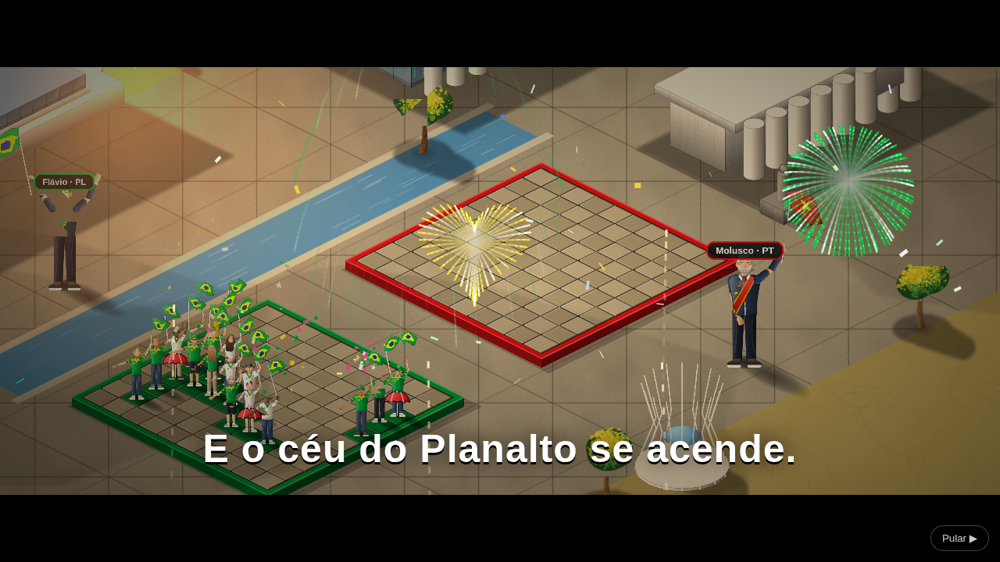 <b>A festa na praça</b> · câmera, torcida e fogos</td>
    <td align="center">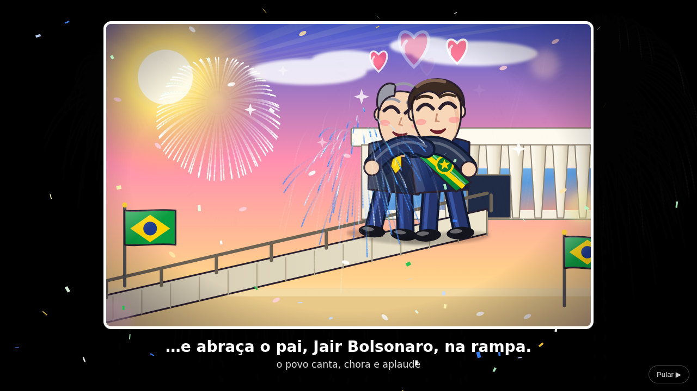 <b>A posse</b> · cena animada no Planalto</td>
  </tr>
  <tr>
    <td align="center">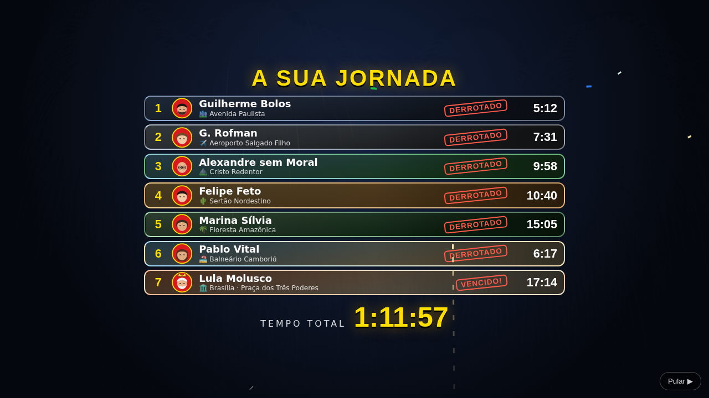 <b>A sua jornada</b> · tempo de cada fase</td>
    <td align="center">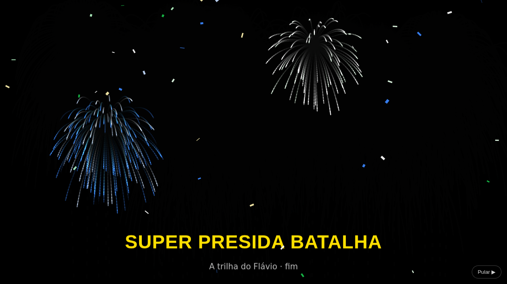 <b>O placar</b> · votos e melhor tempo</td>
  </tr>
</table>

### ⏱️ Cronômetro de jogo
O relógio no topo da tela **conta o tempo jogado na trilha** (posicionando e batalhando). Pausa, menu e tela de resultados **não contam**, e o relógio **nunca encerra a partida**:
ele existe para você medir em quanto tempo consegue zerar o jogo. O tempo de cada fase fica salvo junto com o progresso, e o **melhor tempo** de cada trilha é guardado no navegador.

---

## ☢️ NG+: Apocalipse

Zerou a campanha e viu os créditos? Um ditador surge das cinzas. **O NG+ é desbloqueado depois dos créditos** e é a fase mais difícil do jogo.

- **Cenário:** terra arrasada, prédios em chamas, **tanques de guerra**, **caças voando** ao fundo e um **cogumelo nuclear** no centro.
- **Inimigo:** o **Generalíssimo Tirano**, um ditador que é contra a democracia (personagem fictício). É o mesmo adversário nas duas trilhas.
- **Exército:** zumbis, soldados e monstros (20 unidades, contra as 17 da sua torcida).
- **☢️ Bombas:** caem a cada turno e atingem uma cruz de 5 casas: antes do seu ataque no inimigo, antes do ataque dele em você.
  A cada 3 rodadas cai uma bomba a mais (até 3).
- **🧟 Zumbis:** cada vez que você erra, surge um zumbi visível na casa. Acerte-o para eliminá-lo. Com **5 zumbis**, a horda invade e morde 5 casas da sua arena.
- **Dificuldade extrema:** o Tirano começa com mais energia e ganha energia extra a cada turno. Quanto mais as suas skills evoluem de nível, mais reforços, energia e zumbis ele traz.

> A dificuldade acompanha a **ameaça** (veja [Ameaça](#️-ameaça)): quanto mais você investe em skills, mais exércitos, bombas e zumbis o Tirano manda.

---

## 🎖️ Níveis, grana, itens e skills

A progressão é de RPG: **votos são experiência**, a **grana** vem do saque e as **skills** dependem do **nível** do jogador.

### 📈 Nível e experiência
- Cada torcedor adversário derrubado rende **votos** (com combo, até **8x**). Os votos **nunca zeram**, nem quando você perde.
- Ao fim de cada batalha aparece a **tela de resultados** (estilo menu de vitória de RPG clássico): os votos contam, a barra enche,
  o jogador sobe de nível com a animação **LEVEL UP!** e ganha **pontos de skill**. Vencer dá ainda um **bônus de votos**.

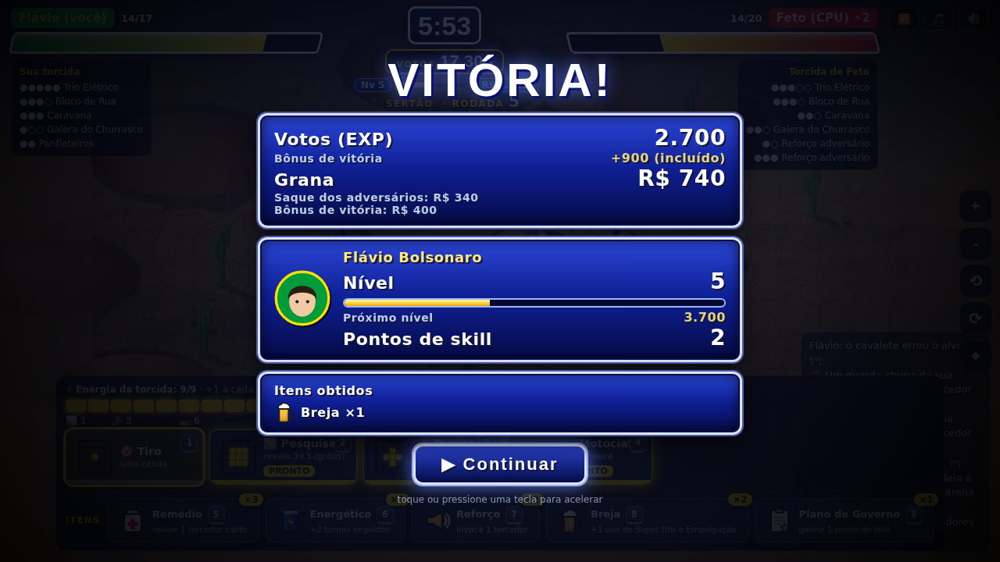

- Níveis de 1 a 15, com experiência acumulada de **1.000, 3.000, 6.000, 10.000, 15.000…** votos (`500 × n × (n+1)`).
- Cada nível dá **1 ponto de skill** (e **+1 extra** nos níveis 3, 6, 9, 12 e 15): são 20 pontos no total, e maximizar as 5 skills custa 30. É preciso escolher uma *build*.

### 💰 Grana e saque
- Quando **você** derruba um adversário, ele pode **soltar grana ou um item** (ou nada). O saque aparece ali na arena, com a moeda saltando do corpo.
- A chance sobe com o **combo** e com a **dispersão de um grupo inteiro** (bônus); há um raro **JACKPOT**. Quanto mais avançada a fase, maior o valor.
- Vitória: **bônus de grana** (e, no chefão, grana extra e itens). Derrota: você **perde metade da grana e os itens que saqueou naquela batalha**, mas **mantém todos os votos**.
- Perigos do cenário (bala perdida, fogo, flechas, bombas) **não** dão saque.

### 🎒 Itens (só na loja ou no saque)
Você começa **sem itens**. Compra na **🛒 Loja** com grana ou os encontra no saque. A mochila guarda **no máximo 9 de cada** (excedente do saque vira grana),
mas **não há limite de uso por fase**. Usar um item **não gasta o turno**.

| Item | Atalho | Efeito | Preço |
|---|---|---|---|
| 💊 **Remédio** (cruz vermelha) | `5` | revive 1 torcedor caído da sua torcida | R$ 400 |
| 🥫 **Energético** | `6` | turnos contínuos: joga 3 turnos seguidos (o atual + 2), sem o adversário agir | R$ 1.000 |
| 📢 **Reforço** (alto-falante) | `7` | invoca 1 torcedor aleatório na sua arena (+1 de vida) | R$ 650 |
| 🍺 **Breja** | `8` | +1 uso de **Super tiro** e **Empolgação** na fase atual (precisa ter aprendido uma delas) | R$ 500 |
| 📜 **Plano de Governo** | `9` | ganha **1 ponto de skill** | R$ 2.500 |

No celular os itens ficam num botão único **🎒 Itens** que abre a lista.

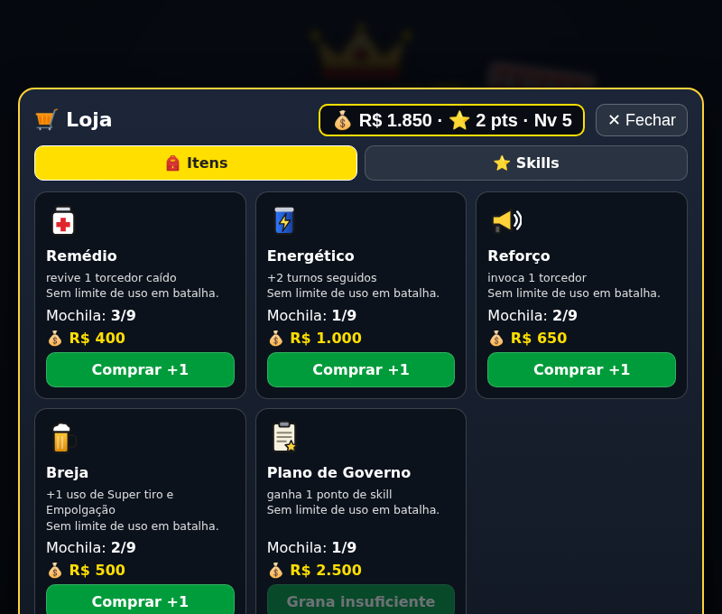&nbsp;

### ⭐ Skills
Aprendidas com **pontos de skill** e **liberadas pelo nível do jogador**. Depois de aprendida, a skill vale em **todas as fases e cenários**, das duas trilhas.
Cada skill tem **3 níveis**; evoluir custa **1, 2 e 3 pontos** e cada nível exige um nível mínimo de jogador:

| Skill | Efeito (nível 1 → 2 → 3) | Nível de jogador exigido |
|---|---|---|
| ⚡ **Fôlego de campanha** | começa a fase com 4 → 6 → 8 de energia | 1 · 4 · 8 |
| 📊 **Instituto de pesquisa** | Pesquisa custa 1 e revela 3×3 → 3×5 → 5×5 | 2 · 5 · 9 |
| ☂️ **Guarda-chuva** | 3 → 5 → 7 torcedores protegidos; o adversário gasta um tiro para quebrar | 3 · 6 · 10 |
| 💥 **Super tiro** | tiro 2×2, 3 → 4 → 5 usos por fase | 5 · 8 · 12 |
| 🎉 **Empolgação** | turno extra ao acertar, 3 → 4 → 5 usos por fase | 7 · 10 · 14 |

**Apoio da torcida:** se você perder no chefão, na tentativa seguinte ganha torcedores extras na sua arena (+1 por derrota seguida, até +3).
Vencer o chefão zera esse apoio.

### ⚖️ Ameaça
Quanto mais skills você **aprende**, mais forte o inimigo fica (mais reforços, energia extra, vida no chefão, bombas e zumbis no NG+). A *ameaça*
soma o peso das skills aprendidas (de 0 a 31) e vai de **Calma** a **Extrema**; evoluir o nível de uma skill já aprendida não aumenta a ameaça.
Como a progressão agora é mais lenta e o jogo começa sem itens, os números de equilíbrio do chefão e do Apocalipse ainda precisam de nova calibração com jogadores reais.

---

## 🌐 Modo online

O botão **JOGAR ONLINE** fica logo na tela inicial. É um **duelo 1×1** com as mesmas regras para os dois (sem skills nem itens), que não rende votos nem grana.

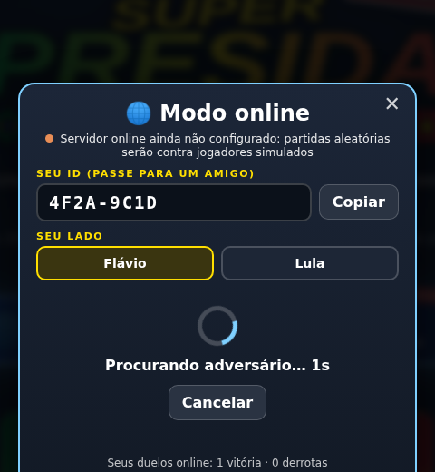&nbsp;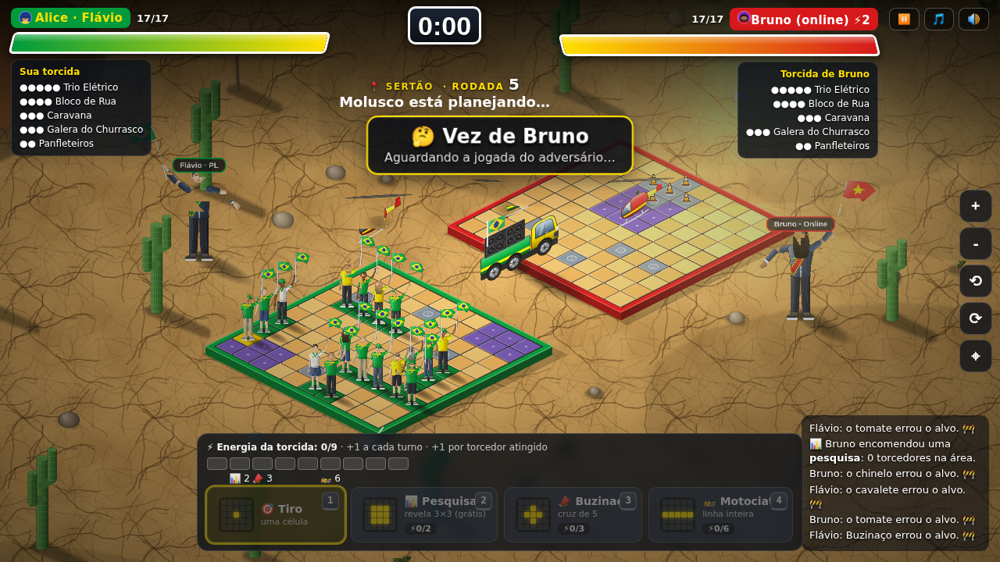

- **Partida aleatória:** o jogo procura outro jogador que também esteja procurando. Se ninguém aparecer em cerca de 10 segundos, entra um **jogador simulado**, e no fim da partida o jogo avisa que o adversário era simulado.
- **Desafio pelo ID:** cada perfil tem um ID (ex.: `A1B2-C3D4`). Digite o ID do amigo para desafiar; ele recebe o convite se estiver com a tela **Online** aberta.
- **Como funciona:** cada jogador guarda o próprio tabuleiro e responde aos tiros do outro, então o do adversário fica escondido. Ao posicionar, cada um envia um *compromisso* (hash) do tabuleiro; no fim os tabuleiros são revelados e conferidos, e quem respondeu algo diferente é flagrado e perde.
- **Rede:** usa o **Supabase Realtime**. Sem configuração (arquivo `js/online-config.js` vazio) o jogo ainda oferece partidas contra jogadores simulados.
- **Tempo:** 45 s por jogada (se estourar, o jogo atira por você). Desistir fica no botão ⏸. Se o adversário sumir por mais de 90 s, você vence.

### Ranking (campanha e online)
O botão **🏆 Ranking** da tela inicial tem duas abas, com 🥇🥈🥉 para os três primeiros e a sua posição fixada embaixo:

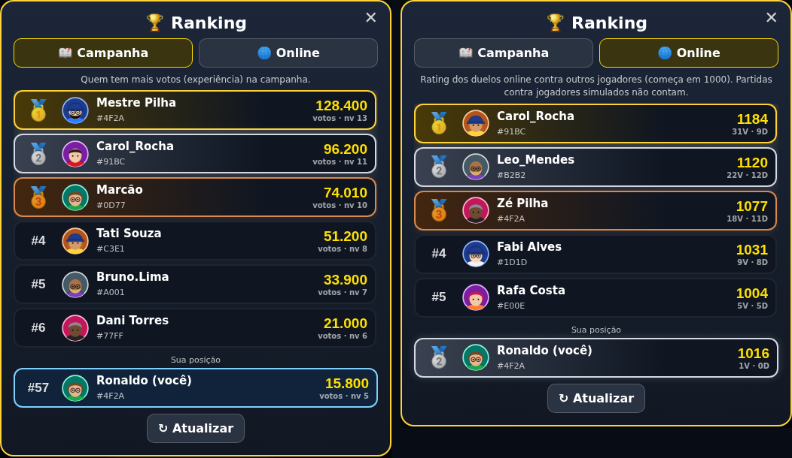 Imagem com dados de exemplo.

- **Campanha:** ordenado por **votos** (experiência). O progresso é enviado ao fim de cada fase vencida.
- **Online:** ordenado por **rating** (tipo ELO, começa em 1000, K = 32). Só conta duelo contra **outra pessoa**: partida contra jogador simulado não vale.
- **Como o rating é validado:** ao fim do duelo cada lado reporta o resultado ao servidor, que só aplica os pontos se os dois relatos batem. Resultados conflitantes viram "disputada" (ninguém pontua, e a acusação de trapaça fica registrada para revisão). Quem desiste admitindo a derrota pontua o outro lado mesmo se este não reportar; vitória sem confirmação não vale. Desistir logo no começo e treinar com a mesma pessoa mais de 5 vezes em 24 h não rendem pontos.
- **Limite:** como o jogo roda no navegador, quem combinar resultados com um amigo ainda consegue inflar o rating. Para um ranking à prova de trapaça seria preciso validar as jogadas num servidor.

### Configurar o servidor (Supabase)
1. Crie um projeto no [Supabase](https://supabase.com). O duelo em si só usa o **Realtime** (já vem ligado) e não precisa de tabelas.
2. Para **ranking e save na nuvem**: em *Authentication → Sign In / Providers*, ligue **Anonymous Sign-Ins**; depois, no *SQL Editor*, cole e rode [`supabase/schema.sql`](supabase/schema.sql) (pode rodar de novo sem problema).
3. Em *Project Settings → API*, copie a **Project URL** e a chave pública **anon** e cole em [`js/online-config.js`](js/online-config.js). Nunca use a chave `service_role` nem a senha do banco.
4. Opcional: *Authentication → Attack Protection → CAPTCHA*, para evitar contas anônimas em massa.
5. Para testar o duelo com duas abas sem servidor: abra o jogo com `?net=local` nas duas.

O jogador é identificado por um login **anônimo** do navegador. Limpar os dados do site cria um novo jogador; o ID do perfil e o backup continuam servindo, e o ranking ligado à conta antiga fica para trás.

---

## 🗺️ Campanhas

A tela inicial tem o **mapa de campanhas**: cada cartão é um *mundo* (uma campanha), com as próximas já visíveis e bloqueadas ("em breve"). O nível, os votos, as skills e os itens do jogador valem em todas, e cada campanha guarda o seu próprio progresso.

Cada campanha é **um arquivo** em [`js/campaigns/`](js/campaigns) (lados, personagens, cenários com desenho, fases, itens, skills, frases e final). Para adicionar um cenário, um personagem ou uma campanha inteira, inclusive pedindo a uma IA, veja o **[Guia de campanhas](CAMPANHAS.md)**. Para validar um pacote: `node tools/check-campaigns.mjs`.

---

## 🙋 Seu perfil

Na primeira vez que abre o jogo você cria o **nome (nick)** e monta o **avatar**. Clique no seu avatar no canto do menu para editar quando quiser.

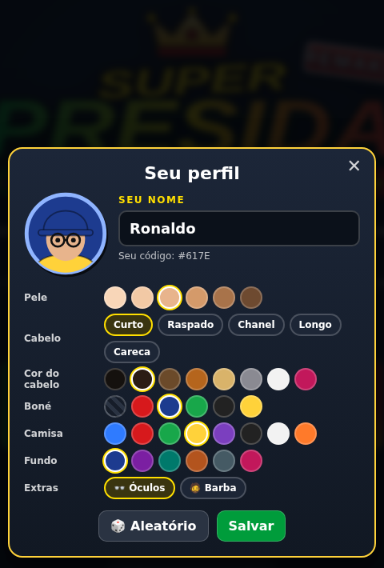&nbsp;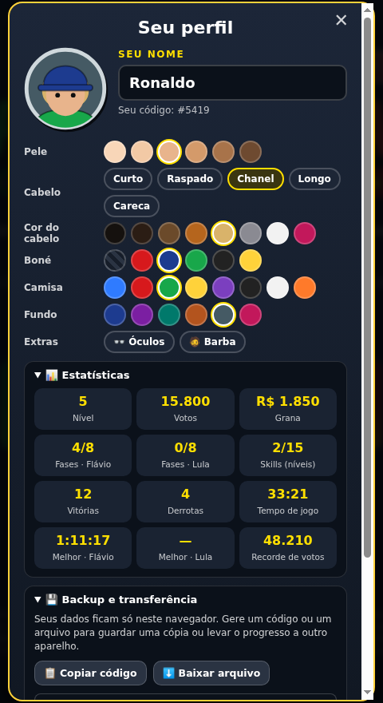

- **Nick:** de 3 a 14 caracteres, com filtro simples de palavrões. O jogo gera um código curto (`Nick#4F2A`) para diferenciar nomes iguais.
- **Avatar:** montado por opções (sem upload de imagem): pele, cabelo, cor, boné, camisa, fundo, óculos e barba.
- **Estatísticas:** nível, votos, grana, fases vencidas por trilha, skills, vitórias e derrotas, tempo de jogo e melhores tempos.
- **Backup (sem servidor):** em *Backup e transferência* você copia um **código** ou baixa um **arquivo** com perfil e progresso, e importa em outro aparelho ou depois de limpar o navegador.
- O perfil fica guardado **à parte do progresso**: "Apagar progresso salvo" não apaga o seu nick nem o avatar.

---

## 🕹️ Como jogar

1. Escolha o lado e a fase.
2. **Posicione** sua torcida (5 grupos) no seu tabuleiro. `R` ou botão direito gira.
3. Na sua vez, **clique numa casa** do tabuleiro adversário. Cada tiro arremessa um objeto de protesto.
4. Acerte para ganhar **votos** e **energia**; gaste a energia nos poderes (`1`–`4`) e use os **itens** (`5`–`9`) com sabedoria. Veja [Níveis, grana, itens e skills](#️-níveis-grana-itens-e-skills).
5. Dispersse toda a torcida adversária (ou derrote o chefão) antes que ele faça o mesmo com a sua.

| Poder | Custo | Efeito |
|---|---|---|
| 🎯 Tiro | 0 | uma casa |
| 📊 Pesquisa | 2 | revela uma área 3×3 (grátis, não gasta o turno) |
| 📣 Buzinaço / Comício | 3 | cruz de 5 casas |
| 🏍️ Motociata / 🚌 Caravana | 6 | linha inteira / coluna inteira |

Energia: **+1 por turno** e **+1 por torcedor atingido**. No celular, a câmera acompanha o turno.

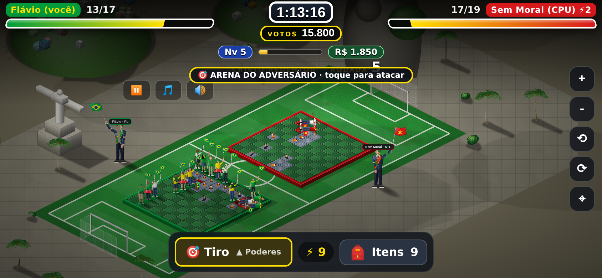

### ⏸ Pausa

- **Pausa:** botão ⏸ no topo (ou `Esc`) congela o jogo e abre o menu com **Continuar**, **Reiniciar a fase** e
  **Sair para o menu principal**. Reiniciar ou sair desfaz os votos, a grana e os itens ganhos ou gastos na fase em andamento.
- Não existe modo desenvolvedor no jogo publicado. Para testar localmente (`localhost`): `?net=local` (duelo entre duas abas sem servidor) e `?pack=js/campaigns/…` (carrega um pacote de campanha), que **só funcionam na máquina do desenvolvedor**.

## 🛠️ Tecnologia

- [`index.html`](index.html) (lógica e interface) + [`js/`](js) (`gfx.js` renderer, `art.js` sprites, `scenery.js` cenários, `campaigns/` pacotes de campanha), renderizados com [Phaser 4](https://phaser.io/) via CDN. Sem build e sem backend: é só servir arquivos estáticos (por exemplo, no GitHub Pages).
- Personagens, cenários, músicas, efeitos sonoros e ilustrações são **gerados por código** (canvas 2D, SVG e Web Audio).
- Progresso salvo na **nuvem** (Supabase): veja [Salvamento](#-salvamento).

Para rodar localmente, abra o `index.html` no navegador. Para criar um cenário novo, adicione um objeto em
`SCENARIOS` e uma fase em `LEVELS` (há um comentário `ADICIONE NOVOS CENÁRIOS AQUI`).

---

## 💾 Salvamento

> Privacidade: veja a [Política de Privacidade](PRIVACIDADE.md) (o que é coletado, por quê, por quanto tempo e como excluir).

Com o servidor configurado (Supabase), o **perfil e o progresso ficam na nuvem**, ligados a uma conta **anônima** (sem e-mail nem senha). O navegador guarda só o mínimo:

| No navegador | Para quê |
|---|---|
| `sb-…-auth-token` | a sessão anônima do Supabase (é ela que identifica a sua conta) |
| `spb_epoch` | marca a versão dos dados; se mudar, tudo o que versões antigas guardaram é apagado e o jogador começa do zero |
| `spb_lang` | idioma escolhido (quando existir seletor) |
| `spb_pending` | **temporário**: alterações que ainda não chegaram ao servidor (por queda de rede); apagado assim que sincroniza |

- **O que vai para a nuvem:** perfil (nick e avatar), nível e votos, grana, pontos de skill, skills, itens, fases desbloqueadas e vencidas de cada campanha, tempo de jogo, recordes, estatísticas e preferências de som. Também o ranking (votos e rating online).
- **Quando salva:** poucos segundos depois de cada mudança (fase vencida, compra, perfil) e ao fechar a aba. Não salva no meio de uma partida: se você fechar durante uma fase, volta ao estado do início dela.
- **Sem conexão ao entrar:** o jogo mostra *Tentar de novo* ou *Jogar sem salvar* (continua só em memória).
- **Trocar de aparelho ou limpar os dados do site:** a sessão anônima é perdida e você entra como um jogador novo. Para levar o progresso, use o **backup** (código ou arquivo) no seu perfil: ele é aplicado à conta nova. A conta antiga continua no ranking até ser removida.
- **Apagar:** **"🗑 Apagar progresso salvo"** no menu zera o progresso e mantém o perfil. **"🗑 Excluir a minha conta e os meus dados"** (no perfil, em *Backup e transferência*) apaga do servidor o perfil, o save e o ranking, e volta ao início.
- **Sem servidor configurado** (`js/online-config.js` vazio, só para testes locais): o jogo salva no `localStorage`, como antes.

---

## ☕ Me pague um café

Curtiu? Ajude o desenvolvedor a continuar criando fases. Dentro do jogo há o botão **"Me pague um café"**
com a chave Pix e o QR code:

**Pix (chave aleatória):** `9a706f09-753c-4143-b055-197c082e9201`

---

## ⚖️ Aviso legal e isenção de uso de imagem

**Este é um jogo de paródia e de ficção, feito com fins de entretenimento e humor.**

- **Apartidário e imparcial.** O jogo não é vinculado a nenhum partido, candidato ou campanha e trata os dois
  lados de forma equivalente (mesmas regras, poderes, fases e finais). Não defende nem ataca nenhum lado.
- **Não é propaganda eleitoral.** O jogo não pede voto, não apoia nem combate candidato, partido, coligação
  ou campanha, e não deve ser usado como material de propaganda.
- **Nenhuma imagem real é usada.** Não há fotografias, retratos, vozes ou gravações de qualquer pessoa.
  Todos os personagens são **desenhos originais, estilizados e genéricos**, criados por código, que não
  pretendem retratar fielmente nem representar ninguém.
- **Nomes citados apenas para identificar a paródia.** Os nomes de figuras públicas aparecem em tom de sátira
  e humor político. Falas, situações, poderes e finais são **fictícios** e não representam fatos, declarações,
  posições ou opiniões reais dessas pessoas.
- **Sem vínculo ou endosso.** Nenhuma pessoa, partido, candidato, instituição, órgão público ou empresa
  citados participou, patrocinou, aprovou ou tem qualquer relação com este projeto. Siglas, nomes e marcas
  pertencem aos seus respectivos titulares e são citados apenas de forma descritiva.
- **Sem violência real.** Quem é "atingido" apenas senta, cansado de tanto gritar.
- **Dados mínimos e transparência.** A [Política de Privacidade](PRIVACIDADE.md) explica tudo. O jogo guarda na nuvem (Supabase) apenas o que você cria jogando: nick, avatar, progresso, estatísticas e resultados de duelos, ligados a uma conta anônima. Nick, avatar, votos, nível e rating aparecem no **ranking público**; o seu progresso completo (save) só você lê. No **modo online**, nick, avatar e ID também passam pelo serviço de tempo real (Supabase Realtime) para o adversário ver durante a partida. Ao abrir o jogo também são registrados **dados técnicos de acesso** (país aproximado, tipo de aparelho, sistema e navegador, tela, idioma e fuso; o IP só como hash diário, nunca o IP em si), guardados por **90 dias** e só legíveis pelo dono do projeto. É preciso **aceitar a política** para criar o perfil. Você pode **baixar** os seus dados ou **excluir** tudo a qualquer momento pelo perfil.
- **Jogadores simulados.** Quando não há ninguém online, a partida aleatória é contra um jogador simulado (controlado pelo próprio jogo), e a tela final avisa isso.
- **Pedidos de ajuste ou remoção** podem ser feitos abrindo uma *issue* neste repositório ou contatando
  o autor, e serão analisados com atenção.

> Este texto é informativo e não constitui assessoria jurídica.

---

  Feito com ☕ e paciência por <b>rpossan</b> · <a href="https://github.com/rpossan/super-batalha-presida-remake">github.com/rpossan/super-batalha-presida-remake</a> 
  Remake do <a href="https://github.com/rpossan/super-presida-batalha">Super Presida Batalha original</a>

